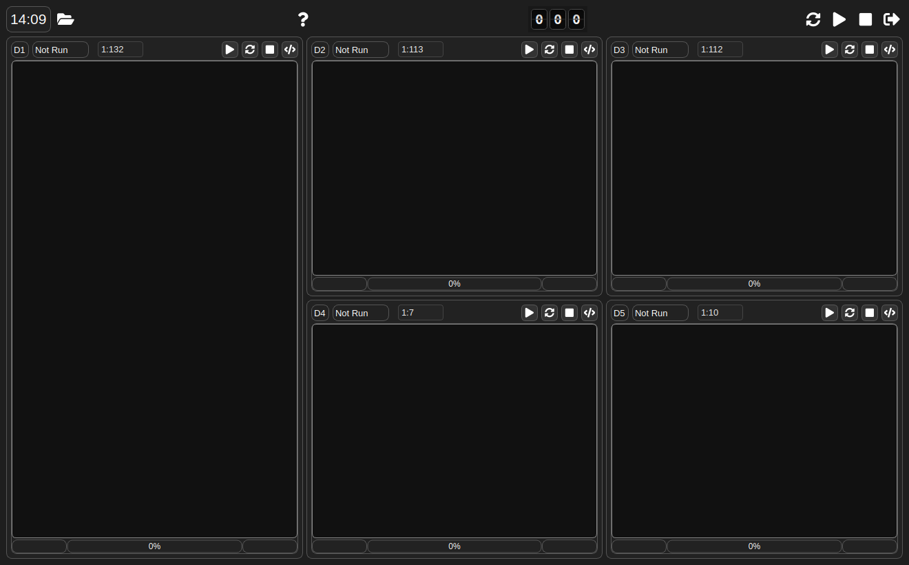

# Firmware Flash Tool

Parallel flashing GUI for **NXP i.MX** boards via the [`uuu`](https://github.com/NXPmicro/mfgtools) (Universal Update Utility). It is a "flasher farm": connect several boards to one Linux PC, pick firmware and boot files, press one button — the app waits for each device, flashes it, and repeats automatically.

Built with **PySide6** (Qt6).



## Features

- Up to **10 flashing panels** (`D1`–`D10`) with individual USB paths.
- Two flash modes:
  - `UuuProcess` — one-shot `uuu -v -m <dev> -b emmc_all <boot> <firmware>`.
  - `UuuScriptProcess` — interactive `uuu -s -m <dev>` session with an `SDPS: boot → FB: flash → FB: reboot` script (used for compressed `.bz2`/`.zip` firmware).
- **AUTO mode** — after finishing, a panel waits for the next device and flashes again.
- **Play (once)** — single run.
- Top group buttons: **All-Auto / All-Once / All-Stop**. Flash counter (top-right) with right-click **Edit… / Clear**.
- **USB monitor** — background scan for NXP devices (VID `0x1fc9`, `0x15a2`) with an overlay, panel highlighting and activity blink.
- **Progress bar with calibration** — uses `uuu` percentages when available, otherwise byte progress with a one-time calibration session for compressed images.
- Per-panel log with noise filtering; click a panel title to see the last error.
- **Fullscreen** (F11) and hotkeys to switch the number of active panels.
- **Dark QSS theme** (`data/dark.qss`).
- **Bilingual help** (Russian + English) with locale auto-detection.

## Requirements

- Linux
- Python 3.9+
- [`uuu`](https://github.com/NXPmicro/mfgtools) in `PATH`
- `libusb` / `udev` (the installer handles this)
- Python deps (see `scripts/requirements.txt`): `PySide6`, `paramiko`, `qtawesome`

## Install

```bash
# 1. System dependencies: uuu, libusb, udev rules for NXP SDPS devices
./install_firm_tool.sh

# 2. Launcher: creates/uses a shared venv and (re)creates desktop shortcuts
./run.sh
```

`run.sh` is portable: it resolves the project directory from its own location, so it works from any path on any machine.

- Shared virtualenv: `$HOME/.venv` (no per-project envs)
- Desktop entries: `~/.local/share/applications/` and `~/Desktop`
- Override language: `UUU_LANG=en ./run.sh` (or `ru`)

## Usage

1. Click the **folder** button (*Firmware / boot files*) and pick `firmware` and `boot`.
2. Set each panel's USB path (e.g. `1:7`), press **Enter**. View devices with **F10**.
3. Put boards into **Serial Download (SDPS)** mode.
4. Press **Play** on a panel for one run, or **AUTO** for continuous mode.

### Hotkeys

| Key | Action |
|---|---|
| `Ctrl+A` | AUTO for all panels |
| `Ctrl+R` | Flash all once |
| `Ctrl+S` | Stop all panels |
| `Ctrl+U` | Toggle process mode (UuuProcess / UuuScriptProcess) for all |
| `Ctrl+1..9` / `Ctrl+0` / `Ctrl+X` | Number of active panels (0 and X = 10) |
| `Ctrl+Q` | Quit |
| `F10` | Show/hide USB panel |
| Double `F10` | Pin/unpin USB panel |
| `F11` | Fullscreen |
| `Alt+A/S/R/U`, then `1..9/0` or `X` | Per-panel action (X = all active): A=auto, S=stop, R=once, U=process |

## Project structure

```
uuu_app/
├── run.py        # QApplication entry point
├── app.py        # FlasherFarmApp (QMainWindow)
├── panel.py      # DevicePanelWidget — one device panel
├── proc.py       # UuuProcess, UuuScriptProcess, reboot_device()
├── ovl.py        # UsbDevicesOverlay, FileSettingsOverlay
├── ui.py         # ClickableLabel, RoundedProgressBar, PanelSignals
├── cfg.py        # paths, config, QSS, progress calibration, i18n
├── qt.py         # PySide6 import shim (Signal/Slot)
├── usb_scan.py   # `uuu -lsusb` parser
├── util.py       # format_t, is_main_log_noise
└── info.md       # detailed internals (RU)
```

Supporting files:

```
run.sh                    # portable launcher
install_firm_tool.sh      # system deps + desktop entries (legacy venv)
run_uuu_app.py            # thin entry point
data/dark.qss             # dark theme (required)
data/help_text.json       # bilingual help (ru/en)
data/firmware_config.json # auto-generated user state (not committed)
icons/                    # app icons
firm_file/                # firmware files (not committed)
scripts/requirements.txt  # Python dependencies
```

## Configuration

User state is stored in `data/firmware_config.json` (auto-created on first save): selected firmware/boot, history (last 10), panel USB paths, progress hints, overlay position. Firmware files live in `firm_file/`.

## Troubleshooting

- **`uuu: command not found`** — install `uuu` (`./install_firm_tool.sh`) and make sure it is in `PATH`.
- **`.bz2` flashed silently with no write** — use `UuuScriptProcess` (the `</>` button) so `FB: flash ... <firmware>/*` runs.
- **`Fail` mid-session** — the session is aborted (no blind retries), since a partially flashed board must not be re-flashed blindly.
- **Progress stuck at 0%** — the panel is calibrating; after the first successful run the size hint is saved and reused.
- **No theme** — ensure `data/dark.qss` exists next to the app (it is required, not auto-generated).

## License

See repository settings. Add a `LICENSE` file if you plan to publish under a specific license.